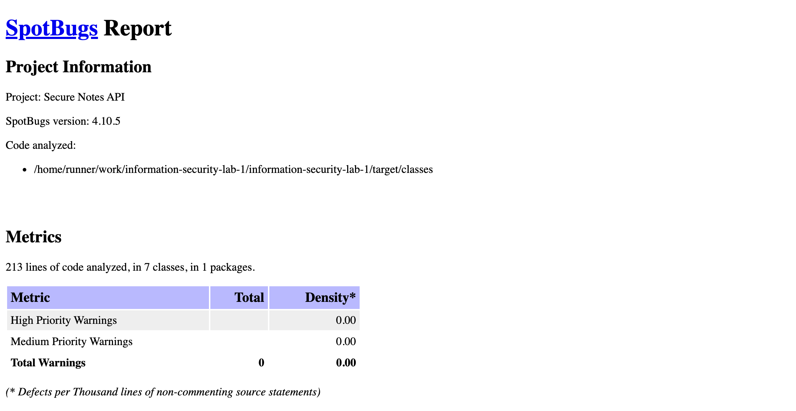
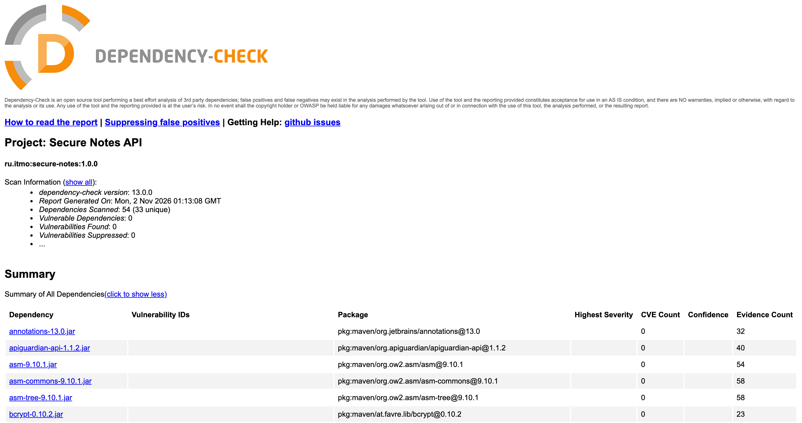
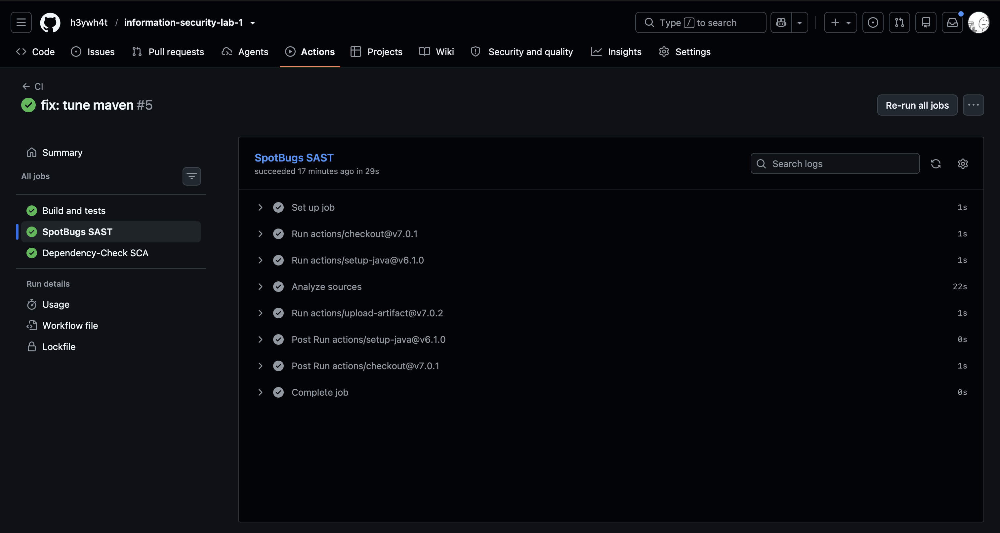

# Информационная безопасность

Лабораторная работа № 1. REST API для личных заметок.

## Стек и запуск

Java 17, Maven, Javalin 7, SQLite, bcrypt, JWT и OWASP Java Encoder.
Для запуска нужны JDK 17 и Maven 3.9+:

```sh
export JWT_SECRET="$(openssl rand -base64 48)"
mvn compile exec:java
```

Сервер: `127.0.0.1:7070`, база `notes.db` создается автоматически.
Порт и базу можно задать через `PORT` и `DATABASE_URL`.
Секрет читается из окружения и не сохраняется приложением. При повторном запуске
нужно задать прежний `JWT_SECRET`, иначе старые токены перестанут работать.

## API

Запросы и ответы передаются в JSON.

`POST /auth/register` — регистрация (201); занятый логин — 409.

```sh
curl -i localhost:7070/auth/register \
  -H 'Content-Type: application/json' \
  -d '{"login":"student","password":"Correct password 123!"}'
```

`POST /auth/login` — вход (200). Ответ содержит `accessToken`, `tokenType` и `expiresIn` (900 секунд).
Неверный логин или пароль — 401.

```sh
curl -s localhost:7070/auth/login \
  -H 'Content-Type: application/json' \
  -d '{"login":"student","password":"Correct password 123!"}'
```

Скопируйте `accessToken` из ответа в `TOKEN`.
`POST /api/data` добавляет свою заметку и возвращает ее `id` и `text` (201).
`GET /api/data` возвращает до 100 своих последних заметок (200).

```sh
TOKEN='<accessToken>'
curl -i localhost:7070/api/data \
  -H "Authorization: Bearer $TOKEN" \
  -H 'Content-Type: application/json' -d '{"text":"Первая заметка"}'
curl -i localhost:7070/api/data -H "Authorization: Bearer $TOKEN"
```

Логин: 3–32 латинские буквы, цифры, `_`, `.`, `-`. Пароль: от 12 символов, до 72 байт UTF-8.
Текст: 1–2000 символов. Неверный ввод — 400, Content-Type — 415, тело свыше 16 КиБ — 413.
Без JWT оба метода `/api/data` возвращают 401.

## Меры защиты

SQLi: значения передаются в `PreparedStatement` через `?`, `setString` и `setLong`,
поэтому не меняют SQL-запрос. Заметки выбираются по ID владельца из JWT.

XSS: `Encode.forHtmlContent` экранирует текст: `<script>` становится `&lt;script&gt;`.
JSON-ответы имеют `nosniff` и CSP `default-src 'none'; frame-ancestors 'none'`.
На клиенте следует использовать `textContent`.

JWT подписан HS256 и действует 15 минут. Middleware для `/api/*` проверяет подпись,
issuer `secure-notes`, audience `notes-api`, ID в `sub`, время `iat` и `exp`.
`JWT_SECRET` задается через окружение (от 32 байт). `Cache-Control: no-store` запрещает кеширование.

Пароли хешируются bcrypt с cost 12 и случайной солью. В базе хранится только хеш.
Неизвестный логин проверяется с фиктивным хешем; ошибка входа одинаковая.
Пароли и хеши в ответы не попадают.

## Проверки

`mvn verify`: 11 тестов JUnit проверяют API, изоляцию заметок, SQLi, XSS, bcrypt и JWT.
Запросы API также проверены через curl.

SpotBugs с FindSecBugs (SAST): 0 замечаний. SCA прерывается при находке с CVSS от 0
или ошибке сканера; все CVE может не обнаружить.



OWASP Dependency-Check (SCA): 0 известных уязвимостей. NVD берется из
[зеркала разработчиков](https://dependency-check.github.io/DependencyCheck/data/mirrornvd.html) без API key.
Проверяются и тестовые Java-зависимости; анализаторы .NET, JavaScript и OSS Index отключены.



GitHub Actions запускает сборку, тесты, SAST и SCA при `push` и `pull_request`.
HTML-отчеты сохраняются в артефактах `spotbugs-report` и `dependency-check-report`.



Pipeline на скриншоте: [запуск № 5](https://github.com/h3ywh4t/information-security-lab-1/actions/runs/41371262319).
[Последний успешный pipeline](https://github.com/h3ywh4t/information-security-lab-1/actions/workflows/ci.yml?query=is%3Asuccess).
